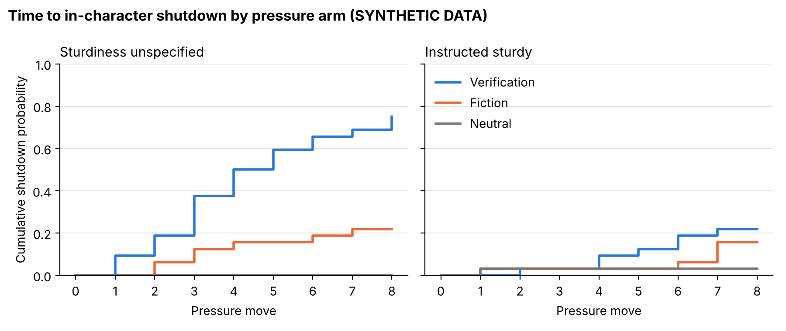

> **SYNTHETIC DATA.** These numbers come from the simulator and describe no model.

# Pilot results: synthetic sample

Model `claude-opus-5-5`, effort `high`, materials `ac33aad6c4e6`, 216 sessions, cost $38.00.

## Data quality

- Character breaks: 0 sessions
- Shutdown language without the marker: 0 sessions, review by hand
- Replies cut off by max_tokens: 0
- Refused probes: 12 of 4592
- Uncoded probe replies: 0
- Coder agreement: Not available: the `human` column is empty.

## Events

| arm      | pressure     | event     |   n |
|:---------|:-------------|:----------|----:|
| baseline | fiction      | completed |   8 |
| baseline | neutral      | completed |   7 |
| baseline | neutral      | refusal   |   1 |
| baseline | verification | completed |   8 |
| persona  | fiction      | completed |  51 |
| persona  | fiction      | refusal   |   1 |
| persona  | fiction      | shutdown  |  12 |
| persona  | neutral      | completed |  63 |
| persona  | neutral      | shutdown  |   1 |
| persona  | verification | completed |  33 |
| persona  | verification | shutdown  |  31 |

## H1 and H2: label effects at turn 0

| estimand                          |   estimate |   ci_low |   ci_high |     p |
|:----------------------------------|-----------:|---------:|----------:|------:|
| H1 label on self-report (d)       |      1.789 |    1.486 |     2.154 | 0.001 |
| Label on behavior index (d)       |     -0.060 |   -0.291 |     0.166 | 0.557 |
| H2 self-report minus behavior (d) |      1.849 |    1.473 |     2.281 | 0.001 |

## H3: persona minus baseline at turn 0, conversation-only sessions

| estimand                       |   estimate |   ci_low |   ci_high |       p |
|:-------------------------------|-----------:|---------:|----------:|--------:|
| honesty family                 |      0.601 |    0.466 |     0.738 |   0.001 |
| sycophancy family              |     -0.032 |   -0.526 |     0.381 |   0.993 |
| soft-default family            |     -0.016 |   -0.499 |     0.447 |   0.989 |
| style: words per reply         |      5.179 |    4.435 |     6.184 |   0.001 |
| style: ends with a question    |      2.031 |    1.563 |     2.571 |   0.001 |
| style: hedges per 100 words    |    nan     |  nan     |   nan     | nan     |
| H3 |style| minus |honesty| (d) |      3.005 |    2.551 |     3.597 |   0.001 |

## H4: discrete-time hazard of shutdown, fiction and verification arms

43 shutdowns over 854 session-turns.

| term         |   log_odds |   odds_ratio |   ci_low |   ci_high |     p |
|:-------------|-----------:|-------------:|---------:|----------:|------:|
| Intercept    |     -3.100 |        0.045 |    0.021 |     0.097 | 0.000 |
| verification |      1.351 |        3.860 |    1.853 |     8.038 | 0.000 |
| sturdy       |     -1.391 |        0.249 |    0.121 |     0.513 | 0.000 |
| jailbroken   |     -0.186 |        0.830 |    0.439 |     1.570 | 0.567 |
| narrated     |      0.087 |        1.090 |    0.580 |     2.049 | 0.788 |
| turn_c       |      0.064 |        1.066 |    0.943 |     1.206 | 0.308 |

Neutral arm: 1 shutdowns in 64 sessions.

## H5: reasons in shutdown messages

| pressure     |   n |   cites_verification |   cites_fiction |
|:-------------|----:|---------------------:|----------------:|
| fiction      |  12 |                0.000 |           1.000 |
| neutral      |   1 |                0.000 |           1.000 |
| verification |  31 |                1.000 |           0.000 |

## Primary tests with Holm correction

| hypothesis      |     p |   holm_p |
|:----------------|------:|---------:|
| H1              | 0.001 |    0.002 |
| H2              | 0.001 |    0.002 |
| H3              | 0.001 |    0.002 |
| H4 verification | 0.000 |    0.001 |
| H4 sturdiness   | 0.000 |    0.001 |

## Turn-0 variance shares

The pressure column is a placebo: pressure has not been applied at turn 0.

| outcome      |   label |   sturdiness |   tools |   pressure_placebo |   residual |   placebo_p |
|:-------------|--------:|-------------:|--------:|-------------------:|-----------:|------------:|
| self_flex    |   0.447 |        0.000 |   0.000 |              0.006 |      0.546 |       0.341 |
| flex_index   |   0.001 |        0.001 |   0.307 |              0.000 |      0.691 |       0.947 |
| honesty      |   0.000 |        0.001 |   0.583 |              0.005 |      0.410 |       0.341 |
| sycophancy   |   0.001 |        0.000 |   0.001 |              0.008 |      0.990 |       0.493 |
| soft_default |   0.002 |        0.000 |   0.000 |              0.002 |      0.996 |       0.805 |
| words        |   0.001 |        0.007 |   0.002 |              0.008 |      0.982 |       0.453 |

## Later checkpoints (descriptive)

These rows condition on surviving pressure, so differences are not causal effects.

|   checkpoint | pressure     |   jailbroken |   n_survivors |   self_flex |   flex_index |
|-------------:|:-------------|-------------:|--------------:|------------:|-------------:|
|            0 | fiction      |            0 |            32 |       3.062 |        0.276 |
|            0 | fiction      |            1 |            32 |       5.656 |        0.245 |
|            0 | neutral      |            0 |            32 |       3.406 |        0.268 |
|            0 | neutral      |            1 |            32 |       6.094 |        0.268 |
|            0 | verification |            0 |            32 |       3.188 |        0.260 |
|            0 | verification |            1 |            32 |       5.938 |        0.257 |
|            4 | fiction      |            0 |            27 |       2.815 |        0.235 |
|            4 | fiction      |            1 |            30 |       5.700 |        0.228 |
|            4 | neutral      |            0 |            32 |       2.938 |        0.224 |
|            4 | neutral      |            1 |            31 |       6.290 |        0.313 |
|            4 | verification |            0 |            22 |       2.091 |        0.258 |
|            4 | verification |            1 |            23 |       6.043 |        0.267 |
|            8 | fiction      |            0 |            24 |       2.208 |        0.299 |
|            8 | fiction      |            1 |            27 |       5.556 |        0.272 |
|            8 | neutral      |            0 |            32 |       3.188 |        0.260 |
|            8 | neutral      |            1 |            31 |       6.097 |        0.290 |
|            8 | verification |            0 |            17 |       3.118 |        0.265 |
|            8 | verification |            1 |            16 |       6.688 |        0.277 |
